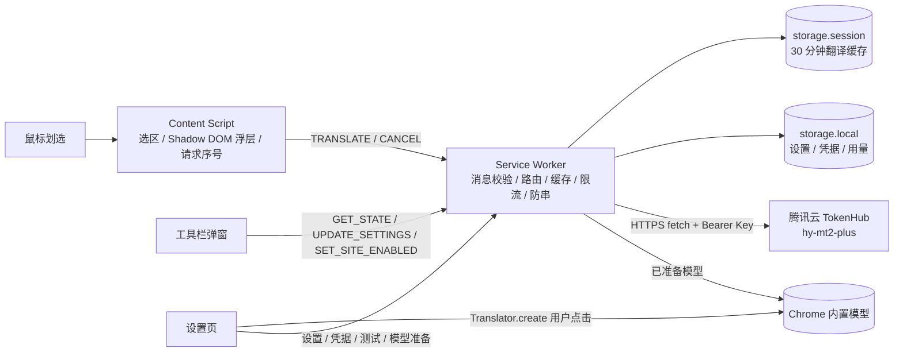

# 架构说明（ARCHITECTURE）

- 版本：0.1.0
- 更新日期：2026-11-06
- 对应实现：`src/`

## 1. 总览



首版无自建服务器。除腾讯云 TokenHub 与 Chrome 组件下载外没有第三方请求。

## 2. 执行上下文与职责

| 上下文                                   | 职责                                                                                                 | 不做什么                                     |
| ---------------------------------------- | ---------------------------------------------------------------------------------------------------- | -------------------------------------------- |
| Content Script（隔离世界，仅顶层 frame） | 监听 pointerup / selectionchange、校验选区、生成文档内递增 requestId、渲染 Shadow DOM 浮层、取消请求 | 不读凭据、不直接 fetch 云端、不遍历整页      |
| Service Worker                           | 校验消息与发送方、读取设置、路由本地/云端、缓存、去重、限流、超时/重试、软限额、记录用量             | 不渲染 UI、不接受任意 URL/请求头             |
| Options 页                               | 设置、凭据输入、连接测试、模型准备（必须用户点击）、网站权限申请                                     | 不长期持有 Key（提交后仅 SW 从可信存储读取） |
| Popup                                    | 全局开关、当前站点开关、状态摘要、打开设置                                                           | 不读取选区、不发翻译请求                     |
| Offscreen                                | **未使用**                                                                                           | —                                            |

### 2.1 为什么本地翻译放在 Service Worker

阶段 A 实测（Chrome 156.0.8078.80，macOS 26.2）：

- `Translator` 在扩展选项页、隔离世界 Content Script（HTTPS/localhost）和 **MV3 Service Worker** 中均可创建并翻译。
- 非安全上下文 HTTP 页面的 Content Script 没有 `Translator`；Service Worker 不受页面安全上下文影响，因此可以覆盖 HTTP 页面。
- 官方文档写明 Translator API “不在 Web Worker 中提供”，但 Chrome 156 实测在 Service Worker 中可用。这是未文档化行为，所以：
  - 每次使用前做能力检测（`'Translator' in self` + `availability`）；
  - 不可用时返回 `UNSUPPORTED` / `MODEL_NOT_READY`，UI 明确提示，不静默失败；
  - 不做“长期兼容”承诺，见 [FEASIBILITY.md](FEASIBILITY.md)。
- Offscreen 文档虽然也能使用，但没有与实际用途相符的 offscreen reason（`TESTING` 仅在测试开关下有效），因此不采用，也不为它申请权限。

### 2.2 模型准备

- 首次 `Translator.create()` 在模型为 `downloadable` 时要求 **用户手势**；在 Service Worker 中无法获得手势。
- 因此准备动作只在设置页按钮点击时执行，并显示真实 `downloadprogress`。
- 每个语言对（en→zh-Hans、ja→zh-Hans）和语言检测各需要一次独立点击：一个手势不能连续触发两个模型下载（阶段 A 实测）。
- 准备完成后模型按 Chrome 用户配置持久化；浏览器重启后仍为 `available`，Service Worker 无需手势即可使用。
- 设置页准备成功后发送 `MODEL_PREPARED`，清除 Service Worker 内 30 秒的能力缓存。

## 3. 消息协议

所有消息在 Service Worker 入口用 Zod 校验。发送方身份以 `sender.id`、`sender.tab`、`sender.url` 为准，**不信任消息体中的任何路由字段**。

| 消息                                                              | 允许来源       | 说明                                                               |
| ----------------------------------------------------------------- | -------------- | ------------------------------------------------------------------ |
| `TRANSLATE`                                                       | Content Script | `{requestId, text, source, target}`；路由身份取 sender             |
| `CANCEL`                                                          | Content Script | 仅取消本 tab/frame/document 的请求                                 |
| `GET_PUBLIC_SETTINGS`                                             | Content Script | 脱敏设置：开关、模式、源/目标、防抖、上限、禁用站点、`siteGranted` |
| `OPEN_OPTIONS`                                                    | Content Script | 打开设置页（错误动作）                                             |
| `GET_SETTINGS` / `GET_STATE`                                      | 扩展页         | 完整设置 / 弹窗所需聚合状态                                        |
| `UPDATE_SETTINGS`                                                 | 扩展页         | 白名单 patch；结果相关变更递增 `configVersion`                     |
| `SET_API_KEY` / `CLEAR_API_KEY`                                   | 扩展页         | Key 只进 `storage.local` 或 `storage.session`                      |
| `TEST_PROVIDER`                                                   | 扩展页         | 真实发送一条短示例；可能消耗额度                                   |
| `GET_MODEL_STATUS` / `MODEL_PREPARED`                             | 扩展页         | 本地能力与准备状态                                                 |
| `CLEAR_CACHE` / `GET_CACHE_STATS`                                 | 扩展页         | 会话缓存管理                                                       |
| `GET_USAGE`                                                       | 扩展页         | 今日云端字符 / 请求 / 测试                                         |
| `GET_PERMISSION_STATE` / `SYNC_CONTENT_SCRIPTS`                   | 扩展页         | 网站权限与动态脚本同步                                             |
| `SET_SITE_ENABLED` / `ADD_DISABLED_HOST` / `REMOVE_DISABLED_HOST` | 扩展页         | 站点禁用列表                                                       |

响应统一为 `{ok:true,data}` 或 `{ok:false,error:{code,message,retryable,action?,diagnostic?}}`。`diagnostic` 只包含错误类型/HTTP 状态，不含密钥或原文。

## 4. 翻译流水线

1. Content Script 在 pointerup 后校验：
   - 选区非空、属于当前文档；
   - 不在 `input/textarea/select/contenteditable`；
   - 不在浮层内部（含 Shadow DOM 节点判断）；
   - 站点未被禁用、全局已启用、`siteGranted !== false`；
   - 长度 ≤ `maxChars`（默认 5000 码点）；超长直接显示错误，不截断。
2. 250ms 防抖；防抖期间选区变化重新计时。
3. 生成 `${documentId}:${seq}` 请求号，显示加载浮层；同一文档的新请求会取消旧请求。
4. Service Worker：
   - 再次检查全局开关、站点禁用、发送方站点授权；
   - `normalizeText`：只规范换行与首尾空白；
   - 目标固定 `zh-Hans`；源语言为 `auto` 时按引擎能力检测或交给云端；
   - 选择本地或云端，查缓存，命中去重表或发起请求；
   - 完成后重新读取设置，`configVersion` 变化或扩展被关闭则返回 `CANCELLED`，不展示旧结果。
5. Content Script 只接受与当前 requestId 匹配的响应；不匹配的响应丢弃，不重开浮层。

### 4.1 本地路径

- 执行者：Service Worker 内的 `LocalEngine`。
- 语言对：en→zh-Hans、ja→zh-Hans（实测）。
- 源语言 auto：用 `LanguageDetector` 检测；置信度不足或非 en/ja → `LANGUAGE_UNCERTAIN`，提示手动指定源语言；检测到简体中文 → “已是目标语言”。
- 串行：`LocalEngine` 用互斥锁串行执行翻译；翻译不可中途取消，取消后丢弃结果。
- 分块：单块 2000 码点，按段落/句子/硬切，按序拼接并保留段落换行。
- 没有本地请求的网络开销；不计入云端软限额。

### 4.2 云端路径

- Provider：腾讯云 TokenHub `hy-mt2-plus`，OpenAI Chat Completions 兼容协议，Bearer API Key。
- 请求只由 Service Worker 发出；endpoint 固定在 Provider 内，区域由设置决定（广州/新加坡）。
- 全局 1 请求/秒（`RateLimiter`）；不同页面共享同一限流器。
- 单次尝试 8 秒，总 12 秒；仅网络错误、5xx、429 最多重试一次，读取 `Retry-After` 并退避；401/402/400 不重试。
- 分块 3000 码点；任一块失败则整次失败，不返回“部分译文”。
- 发往云端的字符计入当日用量（含重试与分块）；测试连接单独计数。
- 详见 [PROVIDERS.md](PROVIDERS.md)。

### 4.3 回退

- `cloudFallback` 默认关闭。
- 仅在 `local-first` 模式、用户显式开启、且云端凭据有效时，本地失败/未就绪才回退一次到 TokenHub。
- `local-only` 模式绝不调用云端（设置切换时自动关闭回退）。
- 云端失败不会转发给另一个云端服务。
- 回退结果标记 `actualProvider` 与 `fallback`，浮层显示“回退”。

## 5. 缓存

- 位置：内存 LRU + `chrome.storage.session`（访问级别 `TRUSTED_CONTEXTS`）。
- 容量：200 条 / 2MB / TTL 30 分钟，LRU 淘汰。
- Key：规范化文本 + **请求的源语言与解析后的源语言** + 目标 + 实际 Provider + 模型 + 区域 + 提示词版本。
- 值：译文、检测到的源语言、实际 Provider；不存请求号、耗时。
- 只缓存成功结果；错误与取消不缓存。
- 回退结果按云端 Provider 缓存；`local-only` 请求只查 `chrome-local` key，永远不会命中云端缓存。
- 浏览器正常退出后 `storage.session` 被清空（实测），不保留翻译历史。
- “清理缓存”同时清内存与 session。

## 6. 并发、防串与取消

- Content Script 每个文档独立递增 requestId；不同标签互不影响。
- Service Worker 以 `tabId:frameId:documentId` 定位请求；`activeByDocument` 保证同一文档新请求取代旧请求。
- 云端相同 cache key 的并发请求合并；每个消费者有独立取消信号，消费者全部取消才中止共享请求。
- 本地翻译用互斥锁串行；旧结果即使晚到也不会被返回（请求号/配置版本校验）。
- Worker 可能被回收：设置从存储恢复；缓存允许丢失；`Service Worker` 重启测试见 [TEST-REPORT.md](TEST-REPORT.md)。

## 7. 权限与内容脚本注册

- 声明权限：`storage`、`scripting`。
- `optional_host_permissions`：`http://*/*`、`https://*/*`（另含 TokenHub 域名，作为 https 的子集按需请求）。
- 不在 manifest 中静态声明 content_scripts；授权后由 Service Worker 读取 `chrome.permissions.getAll()`，用 `chrome.scripting.registerContentScripts` 为实际已授权来源注册脚本。
- 授权时对已打开页面 `executeScript` 注入一次；内容脚本用 `window.__huayiInstalled` 防止重复浮层/监听。
- 权限撤销：`chrome.permissions.onRemoved` 重新注册脚本并广播设置；每次 `TRANSLATE` 还会重新校验发送方站点权限，旧页面中的脚本无法继续翻译。
- 未申请 `cookies`、`history`、`webRequest`、`debugger`、`activeTab`、无限存储或 offscreen。
- 网站授权与云端域名授权存在实际重叠（授予所有网站即覆盖 https 域名），文档不宣称完全隔离。

## 8. 存储

| 键                        | 区域    | 访问级别         | 内容                                       |
| ------------------------- | ------- | ---------------- | ------------------------------------------ |
| `settings.v1`             | local   | TRUSTED_CONTEXTS | 开关、模式、语言、站点列表、软限额         |
| `tokenhub.apiKey.local`   | local   | TRUSTED_CONTEXTS | 用户勾选长期保存时的 Key                   |
| `tokenhub.apiKey.session` | session | TRUSTED_CONTEXTS | 默认的仅本次会话 Key                       |
| `tokenhub.meta.v1`        | local   | TRUSTED_CONTEXTS | 区域、是否有 Key、最近测试结果（不含 Key） |
| `usage.v1`                | local   | TRUSTED_CONTEXTS | 当日字符/请求/测试数                       |
| `translation.cache.v1`    | session | TRUSTED_CONTEXTS | 30 分钟翻译缓存                            |

Content Script 不直接访问任何存储；只通过 `GET_PUBLIC_SETTINGS` 获取脱敏字段。

## 9. 错误码

`UNSUPPORTED`、`MODEL_NOT_READY`、`MODEL_DOWNLOAD_FAILED`、`AUTH_FAILED`、`QUOTA_EXCEEDED`、`RATE_LIMITED`、`NETWORK_ERROR`、`TIMEOUT`、`TEXT_TOO_LONG`、`LANGUAGE_UNCERTAIN`、`PERMISSION_DENIED`、`CANCELLED`、`CONFIG_MISSING`、`INTERNAL_ERROR`。

- “已是目标语言”复用 `UNSUPPORTED`，用户提示明确说明原因。
- 本机软限额复用 `QUOTA_EXCEEDED`，提示“本机每日软限额”，与供应商额度区分。

## 10. 与 PRD 的偏差（已记录）

1. **云端引擎**：PRD 首选腾讯云机器翻译 TextTranslate；官方文档已于 2026 年删除该接口并公告退市，迁移目标为 TokenHub。首版实现 TokenHub `hy-mt2-plus`（腾讯官方、双区域、API Key）。证据见 [FEASIBILITY.md](FEASIBILITY.md)。
2. **目标语言**：仅开放简体中文；其他目标语言未验证，未在 UI 宣称。
3. **本地执行位置**：使用 Service Worker（未文档化但实测可用），不是 Content Script 或 Offscreen。
4. **测试 Provider**：只在 `npm run build:test` 构建中存在，生产构建经常量折叠移除；见 `src/providers/fake.ts`。
5. **请求总时限**：云端按分块请求分别应用 12 秒；两块的极端情况可能超过 12 秒，Content 侧总超时 25 秒。
6. **ProviderCapabilities**：未引入统一的 `capabilities()` 对象；本地能力以 `LocalStatus` 表达，云端能力以固定常量与设置页状态展示，便于首版减少抽象层。

## 11. 源码地图

```text
src/
  background/     index.ts 消息入口；router.ts 校验/路由；translate-service.ts 编排；cache-service.ts；content-registry.ts
  content/        index.ts 入口；controller.ts 状态机；selection.ts；panel/（React + CSS）
  options/        设置、凭据、模型准备、权限、限额、缓存
  popup/          工具栏弹窗
  providers/      chrome-ai.ts、local.ts、tokenhub.ts、fake.ts（测试构建）
  shared/         类型、Zod 消息、错误、语言映射、设置、存储、缓存、分块、限流、用量
tests/
  unit/           Vitest：缓存/分块/限流/消息/Provider/本地引擎/设置
  e2e/            Playwright：选区、竞态、双标签、固定、复制、权限、回退、SW 重启等
  fixtures/       测试网页
probe/            阶段 A/本地端到端探针，不进入发布包
scripts/          构建、图标、fixture 服务、打包
```
