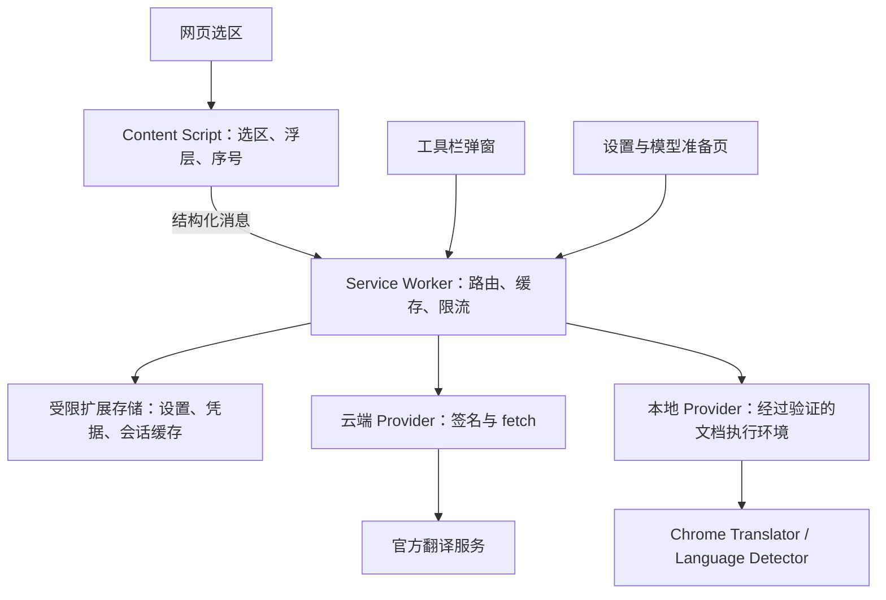

# Chrome 划选翻译扩展 PRD 与开发执行规范

> 文档版本：1.0  
> 日期：2026-11-06（Asia/Shanghai）  
> 状态：需求与实施规划，尚未开发  
> 交付对象：负责开发的工程师或编程大模型  
> 暂定产品名：划译（可更名）

## 1. 产品目标与已确认需求

开发一个桌面 Chrome 扩展：用户在网页中用鼠标划选单词、句子或段落，松开鼠标后，自动在选区附近显示指定语言的译文，减少复制、切换页面和粘贴的操作。

用户已确认：

| 项目       | 已确认内容                                        |
| ---------- | ------------------------------------------------- |
| 主要语种   | 英文、日文翻译成中文                              |
| 主要内容   | 网页中的文字                                      |
| 触发方式   | 鼠标划选文字，松开后自动翻译                      |
| 网络环境   | 国内、海外都需要使用                              |
| 使用对象   | 先自己使用，以后可能公开发布                      |
| 费用接受度 | 优先公开免费接口；接受注册免费 API Key 和少量付费 |
| 核心质量   | 翻译准确、响应快、阅读干扰小                      |

本 PRD 中其余交互、技术选型、限额和默认值均为实施默认方案，执行方可以依据实测调整，但不得擅自改变以上已确认需求。目标语言默认简体中文，设置页允许改为其他已验证支持的语言。

### 1.1 成功标准

- 普通 HTTP/HTTPS 网页的英文和日文选区可稳定翻译成简体中文。
- 无需每次点击翻译按钮；松开鼠标后自动触发。
- 快速连续划选不会出现旧结果覆盖新结果。
- 用户可以明确知道正在使用本地还是云端引擎。
- 国内、海外分别有实测记录，不能以单一网络结果宣称通用可达。
- 首次配置、模型下载、失败和额度不足都有可操作的提示。
- 可通过 Chrome 开发者模式加载构建产物，不要求首版上架商店。

## 2. 范围与版本

### 2.1 P0：首个可交付版本

1. 普通网页的划选自动翻译，支持单词、句子、多段文字。
2. 自动识别源语言，同时允许手动指定英文/日文，默认目标简体中文。
3. 浮层展示：加载状态、译文、引擎名称、复制、关闭、固定、重试。
4. 设置页：全局开关、默认引擎、目标语言、凭据配置、连接测试、网站禁用列表、云端回退开关、缓存清理。
5. 工具栏弹窗：全局开关、当前站点开关、当前引擎、打开设置。
6. Chrome 本地引擎可行性验证；通过验证则接入，未通过则明确禁用，不阻塞完整云端版本交付。
7. 一个真实可用的官方云端引擎，优先腾讯云机器翻译。
8. 请求防抖、结果防串、内存/会话缓存、超时、限流、错误分类。
9. 自用安装文档、密钥配置文档、测试与性能报告。

### 2.2 P1：基础版本完成后的增强

- DeepL 对照实验及第二个云端引擎接入，只有证据显示有价值时才增加依赖。
- 用户主动点击“结合所在句子翻译”，附带有限上下文；默认关闭。
- 同源 iframe、经过验证的跨域 iframe 支持。
- 输入框和 contenteditable 中选区翻译、快捷键及键盘划选。
- 长段落流式显示、简单术语表、可选持久化缓存。

### 2.3 本期排除

悬停即翻译、整页双语翻译、OCR、字幕、音频、系统级鼠标跟踪、账号系统、团队管理、翻译历史、生词本、自动上架、商业计费后台。

Chrome 内部页面、扩展商店等受限页面、内置 PDF 阅读器、Canvas 文本、封闭 Shadow DOM 和特殊在线编辑器不承诺支持。应在说明中列出范围，不能通过扩大权限掩盖平台限制。

## 3. 用户流程与界面

### 3.1 首次使用

1. 安装并打开扩展设置，说明划选触发方式。
2. 检查本地引擎是否存在、语言对是否可用，以及模型状态。
3. 如需模型下载，提供用户可点击的“准备本地翻译”按钮，在实际需要的运行环境执行初始化，显示真实下载进度或不确定进度状态。
4. 本地不可用时，提供腾讯云配置入口；不要求用户必须配置全部引擎。
5. 云端配置页说明：选中文本将发送至所选服务，凭据仅保存在本机扩展存储中。
6. 通过示例短句测试后显示“可使用”；连接测试本身可能消耗额度，旁边简短标明。
7. 用户授权网页访问范围。默认建议所有 HTTP/HTTPS 网站，也可以选择指定站点；未授予访问权限的站点不承诺自动划选翻译。

### 3.2 日常划选

1. 监听主鼠标按钮的 pointerup，读取当前非空选区。
2. 等待默认 250ms；期间选区变化则重新计时。
3. 校验选区属于当前文档、不是扩展浮层内部、页面未禁用、长度在上限内。
4. 保存选区快照和定位矩形，生成 requestId。
5. 显示浮层；命中缓存则直接显示，否则显示加载状态并发起翻译。
6. 返回结果必须匹配最新 requestId、目标语言和引擎配置版本才能展示。
7. 点击浮层外或按 Esc 关闭；新选区到来时更新浮层。

“固定”表示点击外部、选区折叠和滚动时仍保持浮层，固定在当前视口位置；Esc 和关闭按钮仍可关闭。新划选替换现有内容，保留固定状态。首版每个页面只存在一个浮层。

### 3.3 浮层设计

- 默认位于选区末端矩形下方，间距约 8px；空间不足时向上显示，并限制在视口内。
- 默认宽度 360px，最大宽度不超过视口宽度减 24px；长内容内部滚动，保留换行。
- 顶部显示语言方向、实际引擎及固定/关闭；主体显示译文；底部提供复制和重试。
- 切换引擎时展示为独立操作，不自动并行调用多个引擎。
- 使用 Shadow DOM 隔离样式，支持深浅色、文本选择、键盘焦点、可读的按钮标签和状态提示。
- 非固定状态在页面滚动或窗口尺寸变化时关闭，减少跨行选区定位错误；固定浮层始终限制在视口内。
- 点击浮层不触发新翻译；不能让 pointerdown 阻止全部默认行为而破坏复制、选字和键盘操作。
- 只渲染纯文本或框架默认转义文本，不把原文、译文当作 HTML。

### 3.4 边界行为

| 情况                           | 行为                                                   |
| ------------------------------ | ------------------------------------------------------ |
| 空白、单纯空格、选区已消失     | 不请求                                                 |
| 重复选择相同文本               | 允许重新显示；使用匹配配置的缓存                       |
| 多段文字                       | 保留段落边界，不把换行全部压平                         |
| 默认超过 5,000 个 Unicode 码点 | 提示缩小选区；不能静默截断                             |
| 供应商单次长度更小             | 按自然段/句子分块，遵守实际字节或字符限制，按序组合    |
| 中文或其他不确定语言           | 检测不确定时允许手动选择源语言；不假定所有文本都是英文 |
| 目标与源语言相同               | 提示“已是目标语言”，避免无效请求                       |
| 关闭浮层或切换页面             | 取消可取消的请求，过期结果永不重开浮层                 |
| 密码框、可编辑区域             | 首版跳过，不读取密码或输入内容                         |
| 权限缺失/受限页面              | 工具栏显示原因及可用操作                               |

## 4. 翻译引擎与决策规则

### 4.1 选型

| 引擎                  | 定位               | 实施结论                                                         |
| --------------------- | ------------------ | ---------------------------------------------------------------- |
| Chrome Translator API | 首选验证的本地候选 | 不依赖云端翻译请求；必须验证模型准备、英中/日中和扩展运行环境    |
| 腾讯云机器翻译        | P0 官方云端候选    | 国内、海外分别测连接与质量；通过后作为云端默认                   |
| DeepL API             | P1 质量对照候选    | 检查账号可开通性、当前计划、语言支持和实际网络表现后决定是否接入 |
| 百度、Google Cloud    | 替补               | 腾讯不可用或质量不达标时再评估，不在首版同时接入                 |
| 非官方免 Key 网页接口 | 不作为正式依赖     | 不通过抓包、网页爬取或接口轮换实现产品默认功能                   |

截至文档日期，腾讯官方计费页列明文本翻译每月 500 万字符免费额度；DeepL 帮助页列明新的 Developer 计划为累计 100 万字符试用，旧 API Free 不再面向新购买。额度、计划和地区资格可能变化，开发时重新核对官方页面和实际账号。不得把以上信息写成永久承诺。[腾讯计费](https://cloud.tencent.com/document/product/551/35017)、[DeepL 计划](https://support.deepl.com/hc/en-us/articles/360021200939-DeepL-API-plans)

### 4.2 默认与回退

- 最终默认引擎由阶段 A 的质量/速度报告决定。尚无结论时，不能向用户宣称本地更准确或云端必然更快。
- 设置中提供：本地优先、固定云端、本地仅用三种模式；本地仅用模式绝不向云端发送文本。
- “允许本地失败时转云端”默认关闭。开启前说明数据流向；已开启且凭据有效后，可在本地不可用或失败时进行一次云端回退。
- 云端模式由用户明确选择和配置后即可工作，不再逐次确认。
- 鉴权失败、额度不足不自动重复请求；云端失败不自动转发给另一个云端服务。
- 不后台轮询供应商，不每次划选都并行竞速多个服务。
- 本地模型尚未就绪时，不静默等待长时间下载；显示准备入口，或按已授权规则回退。

### 4.3 准确度策略

- 句子和段落完整提交，避免按单词拆分；超限分块优先保持句子完整。
- 默认只发送选中文本，不自动抓取整页。
- 日文仅含汉字、单个短词或英语专有名词时，语言检测可能不可靠，允许手动覆盖源语言。
- 语言代码采用内部规范 en/ja/zh-Hans 等，由各 Provider 映射供应商实际代码。
- P1 上下文最多包含选区所在句子，建议上限 500 码点；只有引擎原生支持上下文时才启用。不能简单拼接上下文导致整句被当作用户要求翻译的内容。

## 5. 技术栈、工具与工程约定

| 层面       | 选择                              | 原因                                 |
| ---------- | --------------------------------- | ------------------------------------ |
| 扩展平台   | Chrome Manifest V3                | 与目标平台一致                       |
| 语言       | TypeScript，strict 模式           | 约束消息协议、Provider 和状态        |
| 构建       | Vite + 明确配置的多入口构建       | 输出静态资源，运行时不依赖开发服务器 |
| 页面 UI    | React + CSS，浮层挂入 Shadow Root | 设置与状态交互统一，样式独立         |
| 扩展 API   | chrome.* + @types/chrome          | 不额外引入跨浏览器层                 |
| 包管理     | npm，提交 package-lock.json       | 接手简单，npm ci 可复现              |
| 运行时校验 | Zod 或等效小型 schema 校验        | 校验跨上下文消息和外部响应           |
| 单元测试   | Vitest                            | 校验路由、缓存、限流、消息、竞态     |
| 浏览器测试 | Playwright Chromium 持久化上下文  | 验证 MV3 扩展与真实选区交互          |
| 人工验证   | 实际桌面 Chrome + DevTools        | 验证内置 AI、权限、模型下载和网络    |
| 规范       | ESLint、Prettier、tsc --noEmit    | 基础静态检查                         |

开发开始时选择彼此兼容的稳定版本，记录 Node.js 版本、Chrome 版本、系统版本并锁定依赖；不要凭记忆编造“最新版”版本号。构建工具最终选择允许在初始化时做一次调整，但必须保留本文的模块边界和可复现构建。

首版无自建服务器、数据库、Docker、Redis 或消息队列。腾讯请求如需签名，在扩展可信后台使用 Web Crypto 按官方算法完成；优先减少 Node 专属 SDK/polyfill。签名参数和接口版本以当前官方文档为准，不在代码中猜测。

## 6. 架构



### 6.1 Content Script

- 在已授权 HTTP/HTTPS 网页的隔离世界运行，P0 仅顶层 frame。
- 处理选区、DOM 定位、浮层和 UI 状态，不持有 API 密钥。
- 监听 pointerup、必要的 selectionchange、滚动、resize 和 Esc；不高频监听 mousemove。
- 不遍历整页提取正文，不修改原文 DOM，不使用网页脚本桥接获取凭据。
- 每个文档独立的递增 selectionVersion；消息以 tab/frame/document 为作用域，不能用全局“最后请求”导致不同标签互相取消。

### 6.2 Service Worker

- 负责校验消息、读取设置、Provider 路由、去重、超时、云端网络请求。
- 使用真实 sender 的 tabId/frameId/documentId，不能相信调用方提供的路由身份。
- 云端请求从扩展后台发出，并声明供应商域名权限；Content Script 不直接 fetch 云端。[Chrome 网络请求](https://developer.chrome.com/docs/extensions/develop/concepts/network-requests)
- Worker 可能休眠或重启：设置从存储恢复；缓存允许丢失，不能依赖全局变量永久存在。
- 消息返回方式必须与目标 Chrome 支持的异步响应机制一致；为长请求设置明确超时，不靠持续空消息维持 Worker 存活。
- 不接受网页传入任意 URL 或任意 HTTP 头；供应商 endpoint 固定在可信 Provider 内。

### 6.3 本地 AI 执行环境：必须先验证

Chrome 官方文档说明 Translator API 需要检查可用性，可能下载模型，创建实例涉及用户激活，且不在 Web Worker 中提供；不能直接放进 Service Worker。[官方文档](https://developer.chrome.com/docs/ai/translator-api)

阶段 A 必须依次验证：

1. 普通扩展设置/模型准备页是否暴露 Translator、LanguageDetector，以及 en→zh、ja→zh 可用性。
2. 用户点击准备按钮后能否完成模型初始化；关闭页面后实际还能在哪个上下文使用。
3. 隔离世界 Content Script 是否可直接使用、是否受宿主页面安全上下文和策略影响。
4. 如需要隐藏文档，再检查 offscreen 文档是否暴露 API、是否有合法适用的 offscreen reason，以及用户激活问题如何满足。
5. 重新启动 Chrome、关闭设置页、切换普通网页、弱网/断网时验证生命周期。

执行规则：

- 选择通过实测、最少权限、无需持续打开可见页面的方案，并把实际消息链和生命周期写入 ARCHITECTURE.md。
- 不能假定在设置页完成的用户激活可转移到 offscreen 文档，也不能跨上下文传递 Translator 对象。
- 不得为了创建 offscreen 文档填写与实际用途无关的 reason；接口可用和 API 使用合法性都要确认。[Offscreen API](https://developer.chrome.com/docs/extensions/reference/api/offscreen)
- 如果只有保持可见扩展页才能工作，可记录为实验模式，不作为默认划选体验。
- 如果无法可靠满足本地模式，P0 发布云端版本，本地标为不可用并记录原因；不要偷偷改为 MAIN world 注入或加入外部本地进程。
- 本地翻译的串行特性要纳入调度，避免旧长任务阻塞新选区。能取消则取消；不能取消则丢弃旧结果，队列只保留最新待执行项。

## 7. 模块接口与数据约定

以下为语义契约，允许按实际 API 调整类型细节，但调整必须同步到实现文档。

```ts
type ProviderId = 'chrome-local' | 'tencent' | 'deepl';
type Language = 'auto' | 'en' | 'ja' | 'zh-Hans' | string;

interface TranslateInput {
  requestId: string;
  text: string;
  source: Language;
  target: Language; // 不允许 auto
  provider: ProviderId;
  configVersion: number;
  context?: string; // P1，用户主动启用后才允许
}

interface TranslateOutput {
  requestId: string;
  translatedText: string;
  detectedSource?: string;
  actualProvider: ProviderId;
  cacheHit: boolean;
  elapsedMs: number;
}

interface TranslationProvider {
  id: ProviderId;
  capabilities(): Promise<ProviderCapabilities>;
  translate(input: TranslateInput, signal: AbortSignal): Promise<TranslateOutput>;
  // 本地语言模型的准备过程独立于划选请求
}
```

ProviderCapabilities 应至少描述可用状态、支持语言/语言对、单次长度及单位、auto source、streaming、context 支持情况；获取不到完整语言列表时，只公布已验证语言对。

消息种类：TRANSLATE、CANCEL、GET_PUBLIC_SETTINGS、UPDATE_SETTINGS、TEST_PROVIDER、GET_MODEL_STATUS、PREPARE_MODEL。设置修改与凭据测试只允许可信扩展页调用；Content Script 仅能读取脱敏配置、翻译与取消自己的请求。模型准备若需要直接用户激活，应在点击所在的文档执行，不能简单转发消息假装保留激活。

统一错误码：UNSUPPORTED、MODEL_NOT_READY、MODEL_DOWNLOAD_FAILED、AUTH_FAILED、QUOTA_EXCEEDED、RATE_LIMITED、NETWORK_ERROR、TIMEOUT、TEXT_TOO_LONG、LANGUAGE_UNCERTAIN、PERMISSION_DENIED、CANCELLED、INTERNAL_ERROR。错误对象包含用户提示、是否可重试和脱敏诊断，不包含密钥或完整原文。

## 8. 性能、并发、缓存和费用控制

### 8.1 请求规则

- 防抖默认 250ms，可在内部配置中调整，不必第一版开放复杂滑块。
- 同一页面最新选区优先；旧请求可中止则中止，中止也不代表供应商未计费。
- 首版云端初始串行、每秒最多发起 1 次请求；依据官方限额和实测可调整，始终不超过账号 QPS。每个页面队列只留最新未发送项。
- 相同文本、语言、引擎、影响结果的配置可合并在途请求；取消某个消费者时不能误取消仍被其他页面使用的请求。
- 不同页面之间保持公平调度，不因单一页面频繁选区无限占用队列。
- 云端单次超时初始 8 秒；仅网络错误、5xx、429 可至多自动重试一次，遵循 Retry-After、退避与总时限。总时限初始 12 秒。
- 用户主动切换引擎/点击重试可新建请求；鉴权、额度和参数错误不自动重试。
- 长文本分块按原顺序组合，保留换行。某一块失败不把部分译文伪装成完整结果，提示不完整并允许重试。

### 8.2 缓存

- 默认只在内存或 chrome.storage.session 保存，关闭浏览器会话后不保留翻译历史。
- 建议容量 200 条、总量上限 2MB、TTL 30 分钟，按 LRU 淘汰。
- Key：规范化文本 + 源/目标语言 + 实际 Provider + 模型/术语/上下文/版本等结果影响项的摘要。
- 仅规范换行和首尾空白，不合并语义相关的段落与空格。
- 回退结果标记实际 Provider，不能写入纯本地模式可命中的缓存。
- 错误和取消不缓存；设置变更能正确隔离旧结果；“清理缓存”清掉所有当前缓存。

### 8.3 费用

- 首次配置提醒用户检查供应商后付费开关、账户预算和额度。
- 扩展提供当天估算发送字符数和可配置的本机软限额，默认建议 20,000 码点/日；可调整或关闭。
- 统计含重试、分块和连接测试；不把缓存命中计为新发送。
- 扩展统计只用于提示，不能宣称等于供应商账单；不同供应商计费单位可能不同。
- 本地软限额不能替代供应商硬性账单控制。

### 8.4 性能目标与测量

以下为目标，不是已达成结果。每个语言对、网络环境至少 30 次短句请求，报告 p50、p95、成功率和样本范围；首次模型准备单列，不能混入热启动指标。

| 指标                                  | 目标                                        |
| ------------------------------------- | ------------------------------------------- |
| pointerup 到浮层可见（含 250ms 防抖） | p95 ≤ 350ms                                 |
| 缓存命中后的处理到展示                | p95 ≤ 100ms，不含防抖                       |
| 本地热启动短句请求到完整结果          | p50 ≤ 1 秒，p95 ≤ 2 秒                      |
| 云端短句请求到完整结果                | p50 ≤ 2 秒，p95 ≤ 4 秒                      |
| 可控条件下普通网页短句成功率          | ≥ 98%，排除权限未授权和不支持页面，单列错误 |
| 无划选时                              | 无翻译网络请求，无持续高频 DOM 扫描         |

短句定义为 20～150 码点；段落另测 500～1,500 码点。若目标未达到，提供真实结果、原因和可选优化，不能修改报告冒充达标。

## 9. 权限、凭据与隐私

### 9.1 权限方案

- 基础权限：storage、scripting。
- 使用 optional_host_permissions 声明 http://_/_、https://_/_，首次引导由用户点击授予全部或具体站点；授权后用 registerContentScripts 注册匹配范围，并正确处理撤销、禁用和重启恢复。
- 授权后对已打开页面注入时，先检查是否已有脚本实例，避免重复浮层/事件监听。
- 云端配置时按需请求供应商域名；不得把网页访问范围当作任意转发 URL 的授权。
- offscreen 仅在通过本地架构验证且实际需要时添加。
- activeTab 仅在存在真实“本页临时启用”功能时添加；它不能替代所有网页自动划选所需的持久授权。
- 不申请 cookies、history、webRequest、debugger、无限存储等无关权限。
- 开发时确认网页访问授权与供应商域名授权的实际重叠，文档如实解释，不宣称权限完全隔离。

### 9.2 存储边界

- 设置/凭据使用 chrome.storage.local，设置 TRUSTED_CONTEXTS 访问级别；页面脚本和 Content Script 不读取凭据。
- 会话缓存使用 chrome.storage.session，同样仅可信上下文访问；如本地运行在 Content Script，只给它必要的非敏感任务数据。
- 不用 storage.sync 存密钥、原文、译文；不把凭据放在 URL、DOM、日志或导出的设置中。
- 扩展存储不是系统保险箱，不承诺本机凭据加密保险级安全；首版接受 BYOK 自用模式，提供删除凭据入口。[Chrome Storage](https://developer.chrome.com/docs/extensions/reference/api/storage)
- 提供凭据“仅本次会话保存”选项；长期保存明确由用户勾选。
- 不上传分析事件，不记录完整原文/译文，不收集鼠标轨迹；日志仅包含脱敏错误、耗时、长度和引擎。
- 翻译文本始终视为不可信数据；不允许文本触发工具调用或执行脚本。
- 所有运行时代码随扩展打包，不从 CDN 加载远程 JavaScript，不使用 eval。

## 10. 目录与脚本

```text
project/
  package.json
  package-lock.json
  tsconfig.json
  vite.config.ts
  manifest.json
  src/
    background/         # 消息入口、路由、缓存、调度、存储
    content/            # 选区控制器、浮层入口、生命周期
    ui/                 # 共享按钮、状态、样式
    popup/              # 工具栏弹窗
    options/            # 配置、凭据、模型准备
    local/              # 验证后确定的本地执行环境
    providers/          # chrome-local、tencent，P1 deepl
    shared/             # 类型、消息 schema、语言映射、错误
  public/icons/
  tests/
    unit/
    e2e/
    fixtures/           # 英日文、跨行、多段、动态页面
    corpus/             # 质量评估文本，不含私人数据
  docs/
    PRD.md
    FEASIBILITY.md
    ARCHITECTURE.md
    INSTALL.md
    PROVIDERS.md
    TEST-REPORT.md
    PRIVACY.md
  dist/                 # 可直接加载的构建产物
  README.md
```

必须提供 npm run dev、build、typecheck、lint、test、test:e2e。测试模式不依赖真实密钥，使用可控假 Provider；真实云端测试单独显式执行，不放进默认 CI。

## 11. 分阶段开发计划与退出条件

### 阶段 A：可行性与引擎决策

任务：核查官方文档与账号限制；制作最小探针，验证本地执行环境、用户激活、模型下载与恢复；验证一个官方云端请求；收集英文/日文各 20 段网页样本做质量对比。

质量评估覆盖单词、短句、多段、术语、否定、数字单位、日文主语省略、同形汉字和长修饰关系。采用人工 1～5 分评估意义准确度、完整性、自然度；优先意义准确度。参考译文应经人工核对，不能把另一个模型输出直接当标准答案。

交付：FEASIBILITY.md，列出系统/浏览器版本、探针代码、运行环境、实际 API 返回、语言对、国内海外结果、质量样本、默认引擎结论和未验证项。

退出条件：至少一个正式引擎真实可用；本地路径可用性有证据。无凭据或缺某地网络时，先完成可独立验证的内容，明确列出所缺信息，不伪造测试，也不因本地不支持而放弃云端开发。

### 阶段 B：扩展骨架与纯 UI 主流程

任务：初始化 TS/Vite/MV3；实现权限引导、选区快照、Shadow DOM 浮层、假 Provider、最新结果保护、全局及站点开关。

退出条件：在自建 fixture 网页中，单词/跨行/多段划选均可展示，旧请求不覆盖新请求；构建产物能在实际 Chrome 加载。

### 阶段 C：真实引擎与设置

任务：接入腾讯 Provider、签名、凭据保存和测试；接入已通过验证的本地路径；语言映射、状态提示、云端回退授权。

退出条件：英→简中、日→简中真实请求成功；无可用凭据时提供明确配置入口；失败不静默更换服务；无密钥泄漏至页面上下文。

### 阶段 D：可靠性与测试

任务：缓存、去重、分块、超时、有限重试、软限额、Worker 重启恢复、连续划选、页面卸载与权限撤销；执行自动化和人工检查。

退出条件：P0 验收项通过，性能报告真实完整；未达目标有明确说明和修复记录，不存在已知的严重内容串位、泄露或无法关闭浮层问题。

### 阶段 E：自用交付

任务：生成 dist 和版本 zip、README、安装与凭据文档、已知限制和隐私说明；核查压缩包无密钥和私有样本。

退出条件：另一位使用者仅按安装文档即可加载、配置并复现基本流程。首版交付结束，不自动上架、不创建账号、不购买付费服务。

### 阶段 F：可选公开发布

另行确认后执行：商店图标截图、隐私政策公开页、单一用途和权限说明、服务条款核查、跨设备兼容性、审核材料。选择用户自带 Key 或独立服务端托管密钥；共享生产密钥永远不打包进扩展。商业后台不在 P0 范围。

## 12. 验收清单与测试矩阵

| 编号 | 场景                                 | 必须结果                                   |
| ---- | ------------------------------------ | ------------------------------------------ |
| AC01 | 英文、日文各选单词/句子/段落         | 自动显示简体中文译文，保留段落             |
| AC02 | A 请求慢、B 请求快，先选 A 后选 B    | 最终仅 B 显示；A 不重开浮层                |
| AC03 | 两个标签同时翻译                     | 结果与取消互不串扰                         |
| AC04 | 点击复制、固定、关闭、Esc、浮层选字  | 各操作正常，不再次触发翻译                 |
| AC05 | 页面边缘、缩放 80%/125%/200%、滚动   | 浮层可见可关闭，无明显溢出                 |
| AC06 | 断网、8秒超时、429、5xx              | 明确错误，重试次数受限                     |
| AC07 | 错误密钥、额度不足                   | 不无限重试，给出设置入口                   |
| AC08 | 关闭云端回退，本地不可用             | 不发生云端请求                             |
| AC09 | 明确开启回退，本地失败               | 一次回退，显示实际云端引擎                 |
| AC10 | 引擎/目标语言/上下文变化             | 不命中不兼容缓存，不展示旧响应             |
| AC11 | 关闭标签、关闭浮层、Worker 重启      | 无结果串位；设置恢复，无永久卡死           |
| AC12 | 恶意 HTML 字样的原文/译文            | 按文本显示，不执行                         |
| AC13 | 检查页面、消息、日志、压缩包         | 无凭据泄露，无完整文本日志                 |
| AC14 | 未授权站点、撤销权限、禁用站点       | 不读选区、不请求；可重新启用               |
| AC15 | 超长文本、单块失败                   | 无静默截断；部分失败明确提示               |
| AC16 | 缓存清理、到期、淘汰                 | 行为符合容量和 TTL，不留持久历史           |
| AC17 | 模型首次下载、失败、重启、离线热启动 | 状态真实；下载失败可恢复，支持范围如实记录 |
| AC18 | 密码框、编辑区、扩展浮层内部选区     | 首版不触发翻译                             |

自动化重点：状态机、请求竞态、缓存隔离、消息校验、限流重试和纯 UI 流程。真实 Chrome 人工重点：内置 AI、用户激活、权限、系统网络、Service Worker 生命周期。Playwright 的 Chromium 环境可能不包含相同的内置 AI 能力，不能用假 Provider 测试代替真实本地验证。

至少覆盖 macOS 当前桌面 Chrome；Windows 作为公开发布前兼容目标。P0 记录实际覆盖系统，不能把未测平台列为已支持。真实网页至少包含文章页、技术文档和动态加载页面；跨域 iframe 与 PDF 单独标注不在 P0 保证范围。

## 13. 执行大模型的工作规则与交付要求

1. 先读取仓库现有 AGENTS.md、代码和本 PRD；保留用户已有修改。
2. 按阶段 A→E 推进，不先堆完整界面再发现引擎不可用。
3. 对尚未验证的 API 能力明确标为假设；只用官方文档核对技术接口。
4. 先以假 Provider 完成可独立开发部分；真实调用需要用户自行配置的凭据时，清楚提出所需字段，通过设置页或本地安全方式配置，不要求在聊天里粘贴密钥。
5. 国内/海外网络不可同时获得时，交付对应测试步骤和待测状态；不得声称已测。
6. 用户已授权的是开发扩展，不包含购买服务、公开发布、上传私人网页内容或在源码中保存凭据。
7. 实现必要功能，避免加入账号、后端、复杂状态库等未要求系统。
8. 每阶段更新文档和证据；完成后执行构建、静态检查及对应测试，修复阻塞问题。
9. 最终交付包含源码、lockfile、dist、版本 zip、安装文档、引擎配置说明、测试报告、已知限制。
10. 不能把假翻译、固定演示结果或未连接的按钮当作正式功能交付；未完成项必须明确说明。

可复制给执行模型的任务指令：

```text
请按 docs/PRD.md 实现 Chrome 划选翻译扩展。
先阅读仓库规范和现有文件，执行阶段 A 的本地 AI 与官方云端可行性验证，
记录事实和未验证项，再依次推进阶段 B～E。
使用 TypeScript + React + Vite + Manifest V3，首版无自建服务器。
默认英/日文到简体中文，划选松开后自动浮层翻译。
本地引擎必须实测，不可用时按 PRD 交付官方云端路径。
没有真实凭据时先完成假 Provider 驱动的工程、UI 和测试，
通过设置页接入用户凭据；不要编造成功记录。
严格实现权限、密钥隔离、请求防串、缓存和云端回退授权。
完成构建、检查、测试以及安装与测试文档后交付源码和可加载扩展包。
未经另行授权，不购买服务或公开发布。
```

## 14. 官方资料与实施时核查清单

本文链接为核查入口，接口和计划可能更新。执行方应在 FEASIBILITY.md 记录实际核查日期与最终采用的信息。

- [Chrome Translator API](https://developer.chrome.com/docs/ai/translator-api)：可用性、语言对、下载、用户激活、流式与执行环境。
- [Chrome Content Scripts](https://developer.chrome.com/docs/extensions/develop/concepts/content-scripts)：隔离世界、注入与 frame 行为。
- [Chrome 跨域请求](https://developer.chrome.com/docs/extensions/develop/concepts/network-requests)：后台请求与 host permissions。
- [Chrome Storage](https://developer.chrome.com/docs/extensions/reference/api/storage)：访问级别、会话存储和容量。
- [Chrome Offscreen](https://developer.chrome.com/docs/extensions/reference/api/offscreen)：文档限制、原因枚举和生命周期。
- [Chrome Permissions](https://developer.chrome.com/docs/extensions/reference/api/permissions)：运行时权限请求与撤销。
- [腾讯机器翻译文档](https://cloud.tencent.com/document/product/551)：从 API 文档核对 TextTranslate、源/目标代码、请求大小、错误码和签名。
- [腾讯机器翻译计费](https://cloud.tencent.com/document/product/551/35017)：当前额度和后付费规则。
- [DeepL 开发文档](https://developers.deepl.com/docs)：语言支持、认证、请求限制、上下文参数。
- [DeepL API 计划](https://support.deepl.com/hc/en-us/articles/360021200939-DeepL-API-plans)：新旧套餐区别与开通条件。

关键未验证项：本地 AI 在扩展中的稳定执行位置、用户实际 Chrome/系统版本、真实云端账号开通资格、国内/海外网络表现、两种语言的质量评分。以上是阶段 A 的工作内容，不是要求用户现在补齐的前置问卷。
